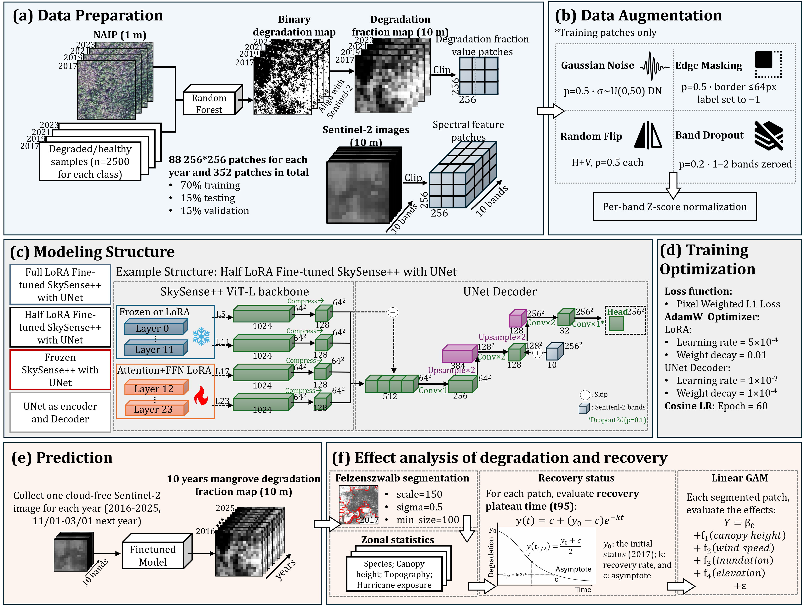
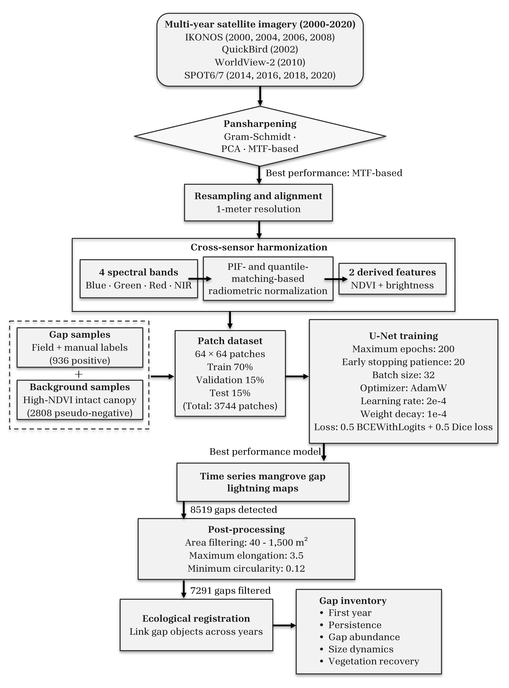

Hello there, this is <strong>Jing</strong>, a Ph.D. student in <a href="https://www.buffalo.edu/cas/geography.html">Geography</a> at <a href="https://www.buffalo.edu/">University at Buffalo</a>, advised by <a href="https://www.buffalo.edu/cas/geography/faculty/faculty_directory/le-wang.html">Prof. Le Wang</a>. Before this, I received my M.S. in <a href="https://geospatial.szu.edu.cn/index.htm">Geo-information and Smart City</a> from <a href="https://en.szu.edu.cn/">Shenzhen University</a> and my B.E. in Surveying and Mapping Engineering from <a href="https://english.sdau.edu.cn/main.htm">Shandong Agricultural University</a>.

Research Interests
------------------

My research focuses on <strong>mangrove forest dynamics</strong> and <strong>coastal resilience</strong> through remote sensing and spatial analysis. Specifically, I am interested in using multi-source satellite imagery and geospatial modeling to characterize mangrove species composition, canopy condition, disturbance, and recovery, with the broader goal of supporting coastal ecosystem monitoring and risk assessment.

Recent Research
---------------

  
Miao, J., &amp; Wang, L. (Manuscript under revision). A cross-scale foundation model framework for annual regional mapping of post-hurricane mangrove degradation and recovery.

  
<strong>Abstract.</strong> This study develops a cross-scale framework for annual mapping of post-hurricane mangrove degradation and recovery across South Florida and the northern Caribbean from 2016 to 2025. High-resolution NAIP-derived degradation labels are used to train a SkySense++ remote-sensing foundation model with a U-Net decoder. The resulting annual maps are then used to examine how species composition, canopy structure, topography, wind exposure, and inundation shape mangrove degradation and recovery trajectories.

  <figure class="workflow-figure">
    
    <figcaption>Workflow for annual post-hurricane mangrove degradation mapping, model training, prediction, segmentation, and recovery analysis.</figcaption>
  </figure>

  
Miao, J., &amp; Wang, L. (2026). Innovative phenological feature extraction for enhanced mangrove species mapping using high-temporal-resolution Harmonized Landsat and Sentinel-2 imagery. <em>Remote Sensing Applications: Society and Environment, 43</em>, 102254. <a href="https://doi.org/10.1016/j.rsase.2026.102254">https://doi.org/10.1016/j.rsase.2026.102254</a>

  
<strong>Abstract.</strong> This study develops a phenology-based framework for mapping three dominant mangrove species, <em>Rhizophora mangle</em>, <em>Avicennia germinans</em>, and <em>Laguncularia racemosa</em>, together with dieback areas using high-temporal-resolution HLS imagery. Second-order harmonic regression is applied to vegetation-index time series to derive phenological parameters, which are integrated into a Gaussian mixture model for probabilistic classification and uncertainty assessment.

  <figure class="workflow-figure">
    
    <figcaption>Workflow for mangrove species classification using high-temporal remote sensing imagery, vegetation-index time series, Gaussian mixture models, and uncertainty assessment.</figcaption>
  </figure>

  
Miao, J., Wang, L., &amp; Sousa, W. P. (2026). Tracking lightning-induced mangrove canopy gaps in Panama using multi-temporal remote sensing. <em>Geo-spatial Information Science</em>, 1–17. <a href="https://doi.org/10.1080/10095020.2026.2751778">https://doi.org/10.1080/10095020.2026.2751778</a>

  
<strong>Abstract.</strong> Lightning-induced canopy gaps play an important role in mangrove regeneration and forest structural dynamics, but their long-term recovery is difficult to observe consistently. This study combines multi-sensor high-resolution satellite imagery, radiometric normalization, U-Net segmentation, and object-based temporal tracking to map mangrove canopy gaps in Panama from 2000 to 2020 and reconstruct gap formation, persistence, re-observation, and recovery.

  <figure class="workflow-figure">
    
    <figcaption>Workflow for detecting and characterizing mangrove canopy gaps using multi-year high-resolution satellite imagery.</figcaption>
  </figure>

  
Miao, J., Wang, J., Zhao, D., Shen, Z., Xiang, H., Gao, C., Li, W., Cui, L., &amp; Wu, G. (2024). Modeling strategies and influencing factors in retrieving canopy equivalent water thickness of mangrove forest with Sentinel-2 image. <em>Ecological Indicators, 158</em>, 111497. <a href="https://doi.org/10.1016/j.ecolind.2023.111497">https://doi.org/10.1016/j.ecolind.2023.111497</a>

  
<strong>Abstract.</strong> This paper maps mangrove canopy equivalent water thickness using Sentinel-2 imagery at the reserve scale and compares machine learning, radiative transfer, and hybrid modeling strategies. It further evaluates how species distribution, slope, elevation, and distance to dam influence the spatial distribution of canopy water status.

  
Miao, J., Zhen, J., Wang, J., Zhao, D., Jiang, X., Shen, Z., Gao, C., &amp; Wu, G. (2022). Mapping seasonal leaf nutrients of mangrove with Sentinel-2 images and XGBoost method. <em>Remote Sensing, 14</em>(15), 3679. <a href="https://doi.org/10.3390/rs14153679">https://doi.org/10.3390/rs14153679</a>

  
<strong>Abstract.</strong> This study compares machine learning models for estimating mangrove leaf carbon, nitrogen, and phosphorus from Sentinel-2 imagery acquired in spring, summer, and winter. The best-performing model is then used to map seasonal leaf nutrient dynamics from 2017 to 2021.

Beyond Research
---------------

Outside of research, I enjoy tennis, basketball, reading novels, and exploring new ideas. Some of my favorite writers are Elena Ferrante and Albert Camus. I am drawn to evening glories, forests, the ocean, and the curiosity that keeps learning alive.
